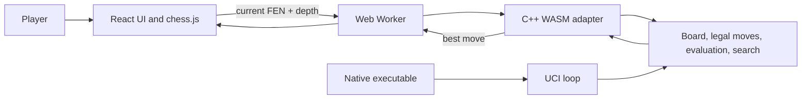

# Knightmare Engine

Knightmare is a C++ chess engine with a React and TypeScript web interface. The native executable speaks UCI; the website runs the same C++ move generator, evaluation, and search compiled to WebAssembly.


## Contents

- [Implemented features](#implemented-features)
- [Clone and play](#clone-and-play)
- [Using with a UCI GUI](#using-with-a-uci-gui)
- [Native development](#native-development)
- [Benchmarking results](#benchmarking-results)
- [Architecture](#architecture)
- [Known limitations](#known-limitations)
- [Roadmap](#roadmap)
- [License](#license)

## Implemented features

### Board and chess rules

- `Board` stores an 8×8 position array, side to move, castling rights, en-passant target, halfmove/fullmove counters, king-square caches, and position history.
- FEN positions can be loaded with validation and serialized back to all six FEN fields. Failed loads preserve the existing board and its histories.
- Moves are represented by `Move`; the board supports make and undo, including restoration of special-move state and position hashes.
- Pseudo-legal moves are generated by piece type and filtered for king safety to produce legal moves. Tests cover all pieces, pins, checks, castling, en passant, and quiet/capture promotions to queen, rook, bishop, or knight.
- The rules layer detects check, checkmate, stalemate, insufficient material, the fifty-move rule, and threefold repetition.
- Evaluation includes material, piece-square values, pawn structure, mobility, king safety, bishop pair, rook-file activity, and piece activity.

### Search and native protocol

- Iterative-deepening negamax search with alpha-beta pruning and quiescence search. Search supports depth, time, clock, node, infinite, and stop limits.
- Move ordering uses principal-variation moves, MVV-LVA/capture and promotion priorities, killer moves, and a history heuristic.
- Deterministic Zobrist hashing and a transposition table are implemented and enabled by default. The native UCI interface exposes hash sizing and clearing.
- Principal Variation Search (PVS) and aspiration windows are implemented as optional settings. Both are disabled by default because the recorded measurements were mixed or slower.
- The native executable implements the tested UCI workflow: handshake, readiness, start-position/FEN commands with move lists, search limits, stop, new game, and hash options. `debug` and `ponderhit` are accepted as no-ops; `go searchmoves` is not implemented.

### Automated correctness tests

The C++ test runner covers FEN parsing/round trips, position validation, legal move rules, make/undo restoration, draw rules, perft node counts, mirrored positions, evaluation, search, hashes, and transposition-table behavior. Search results are compared against a separate minimax reference on fixed positions. A PowerShell UCI integration test communicates with the native executable, and a Node harness exercises the compiled WASM adapter.

### Browser interface

The web app offers **Local Two Player** and **Vs Knightmare**. In engine mode, the human plays White and Knightmare searches as Black. A search depth of 2, 3, or 4 can be selected (default 4). The board, move history, New Game, and Undo are provided by the app. The C++ engine runs in a Web Worker so it does not block the UI thread.

## Clone and play

### Prerequisites

- Git.
- Node.js **20.19+** or **22.12+** (required by Vite 8). npm is used by the project; no npm version is pinned.
- A modern browser with WebAssembly and Web Worker support.

### Run the website

```powershell
git clone https://github.com/Adi123rock/KnightMare-Engine.git
Set-Location YOUR-REPO
Set-Location .\knightmare-web
npm ci
npm run dev
```

Open the URL printed by Vite, normally **http://localhost:5173/**.

1. Choose **Local play** to play both sides on the same board.
2. Choose **Vs Knightmare** to play White against Knightmare as Black.
3. In engine mode, select depth 2, 3, or 4 (default 4) in the Game Room.
4. Use **New game** to reset or **Undo** to take back a move/turn.

The generated engine files required by the website are included at `knightmare-web/public/engine/`. You do not need a C++ compiler or Emscripten to run the website.

## Using with a UCI GUI

The native executable works with UCI-compatible chess GUIs such as Arena, Cutechess, or Lucas Chess.

1. Build the engine (see [Native development](#native-development)) to produce `knightmare.exe`.
2. In your GUI, add a new engine and select `knightmare.exe`, choosing the UCI protocol if asked.
3. Start a game or analysis. The `Hash` option can be changed from the engine settings.

## Native development

This section is only needed to build or test the C++ engine. It requires Windows PowerShell and a C++17-capable `g++` with POSIX threads (`-pthread`). From the repository root:

```powershell
powershell -ExecutionPolicy Bypass -File .\build_engine.ps1
.\knightmare.exe
```

The executable reads UCI commands from the console. To build and run the native search and rules tests:

```powershell
powershell -ExecutionPolicy Bypass -File .\build_search_tests.ps1
.\tests\test_runner_search.exe --fast
```

Use `--slow` for deeper perft, mirror, and search checks. The UCI integration test can be run after building the engine:

```powershell
powershell -ExecutionPolicy Bypass -File .\tests\test_uci.ps1
```

To rebuild the browser module after changing C++ engine/search code, install the [Emscripten SDK](https://emscripten.org/docs/getting_started/downloads.html) and run from the repository root:

```powershell
powershell -ExecutionPolicy Bypass -File .\build_wasm.ps1
node .\wasm\test_wasm.mjs
```

The build script looks for the SDK in `C:\emsdk` by default; set `$env:EMSDK` in the current terminal if it is installed elsewhere.

## Benchmarking results

Both benchmark scripts were run on a Windows workspace on 2026-10-21. These are measurements from a single run, not guaranteed performance.

### Environment

| Item | Observed value |
|---|---|
| Operating system | Windows version `10.0.26200` |
| Compiler | MinGW-w64 x86_64 UCRT POSIX GCC `g++ 16.2.0` |
| Perft build flags | `-std=c++17 -O2 -DNDEBUG -Wall -Wextra` |
| Search build flags | `-std=c++17 -O2 -DNDEBUG -Wall -Wextra -pthread` |
| CPU / hardware | Not recorded |

### Perft benchmark

Perft recursively counts legal move-tree nodes at fixed depths and checks each count against a known value. It tests move-generation correctness; timing and nodes per second describe throughput, not playing strength.

```powershell
powershell -ExecutionPolicy Bypass -File .\tests\run_perft_benchmark.ps1
```

| Position | Depth | Expected nodes | Actual nodes | Time (ms) | Nodes/s | Verified |
|---|---:|---:|---:|---:|---:|---|
| Starting Position | 5 | 4,865,609 | 4,865,609 | 5,515 | 882,109 | Yes |
| Kiwipete | 4 | 4,085,603 | 4,085,603 | 4,521 | 903,612 | Yes |
| Position 3 | 4 | 43,238 | 43,238 | 55 | 777,570 | Yes |
| Position 4 | 4 | 422,333 | 422,333 | 475 | 888,226 | Yes |
| Position 5 | 4 | 2,103,487 | 2,103,487 | 2,347 | 896,033 | Yes |
| Position 6 | 4 | 3,894,594 | 3,894,594 | 4,275 | 910,997 | Yes |

All six counts matched their expected values.

### Search configuration benchmark

```powershell
powershell -ExecutionPolicy Bypass -File .\tests\run_benchmarks.ps1
```

This benchmark searches five fixed positions at fixed depths with quiescence disabled and compares search configurations. The table below shows searched nodes (fewer is better). The script also reports time, nodes per second, score, best move, and transposition-table hits. Every run reported `legal=1`, `restored=1`, and `score_match=1`, and scores and best moves matched across all configurations for each position.

| Position | Depth | Baseline | TT only | PVS only | Aspiration only | TT + PVS + aspiration |
|---|---:|---:|---:|---:|---:|---:|
| Opening start | 5 | 23,996 | 21,791 | 28,274 | 37,653 | 21,592 |
| Middlegame Kiwipete | 4 | 8,668 | 8,696 | 8,346 | 26,946 | 12,245 |
| Tactical hanging queen | 5 | 29,907 | 24,735 | 22,769 | 49,658 | 27,248 |
| Rook ladder endgame | 4 | 2,021 | 1,872 | 2,043 | 2,091 | 1,913 |
| High-branching Position 6 | 4 | 10,115 | 11,035 | 9,680 | 24,722 | 13,157 |

Results vary by position: PVS reduced nodes in some cases and increased them in others, and aspiration-only searched substantially more nodes on several positions. The transposition table is enabled by default, while PVS and aspiration remain opt-in.

These measurements describe work and throughput on five fixed positions. They do not establish playing strength or an ELO rating, and results depend on hardware, compiler, build settings, and system load.

## Architecture



In browser engine mode, React sends the current FEN and selected depth to the Worker. The adapter loads and validates the position, searches a board copy, and checks the returned move against engine-generated legal moves. React then applies the result only if it remains current and legal in `chess.js`. Local Two Player uses `chess.js` directly.

### Project structure

| Folder | Contents |
|---|---|
| `engine/` | Board, move generation, rules, attacks, validation, evaluation |
| `engine2/` | Search, move ordering, timer, search types |
| `src/` | Native UCI entry point |
| `wasm/` | WebAssembly adapter and Node test harness |
| `knightmare-web/` | React + TypeScript web interface |
| `tests/` | Unit tests, perft, search tests, benchmarks |
| `docs/` | Design notes and audits |

## Known limitations

- The browser search is synchronous within its Worker. It keeps the UI responsive, but the Worker cannot handle a stop message until the search returns; stale results are discarded rather than truly cancelled.
- The website offers depths 2–4 for response time. The underlying C++ search and native UCI support deeper searches.
- The WASM harness runs under Node and the Vite build checks Worker bundling; there is no automated browser end-to-end test.
- The benchmark set uses five fixed search positions and six fixed perft positions. No tournament, broad hardware matrix, opponent comparison, or ELO rating is provided.

## Roadmap

- Implement `go searchmoves` in the UCI interface.
- Support a stop that works mid-search in the browser.
- Add an opening book.
- Allow the human to play Black in the web app.
- Add a browser end-to-end test.
- Measure playing strength against other engines.

## License

This project is licensed under the MIT License. See the [LICENSE](LICENSE) file for details.