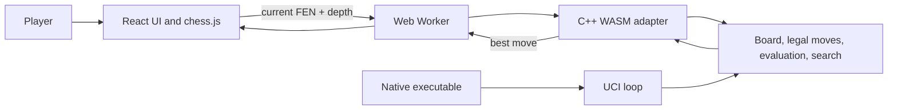

# Knightmare Engine

Knightmare is a C++ chess engine with a React and TypeScript web interface. The
native executable speaks UCI; the website runs the same C++ move generator,
evaluation, and search compiled to WebAssembly.

> No GitHub repository URL or license file was present in the project. Replace
> `OWNER/REPOSITORY` in the clone command with the published repository path.

## Contents

- [Implemented features](#implemented-features)
- [Benchmarking results](#benchmarking-results)
- [Clone and play](#clone-and-play)
- [Optional native development](#optional-native-development)
- [Architecture](#architecture)
- [Known limitations](#known-limitations)
- [License](#license)

## Implemented features

### Board and chess rules

- `Board` stores an 8×8 position array, side to move, castling rights,
  en-passant target, halfmove/fullmove counters, king-square caches, and
  position history.
- FEN positions can be loaded with validation and serialized back to all six
  FEN fields. Failed loads preserve the existing board and its histories.
- Moves are represented by `Move`; the board supports make and undo, including
  restoration of special-move state and position hashes.
- Pseudo-legal moves are generated by piece type and filtered for king safety
  to produce legal moves. Tests cover all pieces, pins, checks, castling,
  en passant, and quiet/capture promotions to queen, rook, bishop, or knight.
- The rules layer detects check, checkmate, stalemate, insufficient material,
  the fifty-move rule, and threefold repetition.
- Evaluation includes material, piece-square values, pawn structure, mobility,
  king safety, bishop pair, rook-file activity, and piece activity.

### Search and native protocol

- Iterative-deepening negamax search with alpha-beta pruning and quiescence
  search. Search supports depth, time, clock, node, infinite, and stop limits.
- Move ordering uses principal-variation moves, MVV-LVA/capture and promotion
  priorities, killer moves, and a history heuristic.
- Deterministic Zobrist hashing and a transposition table are implemented and
  enabled by default. The native UCI interface exposes hash sizing and clearing.
- Principal Variation Search (PVS) and aspiration windows are implemented as
  optional settings; both are disabled by default because the recorded
  fixed-position measurements were mixed or slower.
- The native executable implements the tested UCI workflow: handshake,
  readiness, start-position/FEN commands with move lists, search limits, stop,
  new game, and hash options. `debug` and `ponderhit` are accepted as no-ops;
  `go searchmoves` is not implemented.

### Automated correctness tests

The C++ test runner covers FEN parsing/round trips, position validation, legal
move rules, make/undo restoration, draw rules, perft node counts, mirrored
positions, evaluation, search, hashes, and transposition-table behavior.
Search results are compared against a separate minimax reference on fixed
positions. A PowerShell UCI integration test communicates with the native
executable, and a Node harness exercises the compiled WASM adapter.

### Browser interface

The web app offers **Local Two Player** and **Vs Knightmare**. In engine mode,
the human plays White; Knightmare searches as Black. A search depth of 2, 3, or
4 can be selected (default 4). The board, move history, New Game, and Undo are
provided by the app. The C++ engine runs in a Web Worker so it does not block
the UI thread.

## Benchmarking results

Both existing benchmark scripts were run on this Windows workspace on
2026-10-21. These are measurements from one run, not guaranteed performance.

### Environment

| Item | Observed value |
|---|---|
| Operating system | Windows version `10.0.26200` (reported by the runtime; edition unknown) |
| Compiler | MinGW-w64 x86_64 UCRT POSIX GCC `g++ 16.2.0` |
| Perft build flags | `-std=c++17 -O2 -DNDEBUG -Wall -Wextra` |
| Search build flags | `-std=c++17 -O2 -DNDEBUG -Wall -Wextra -pthread` |
| Machine model / CPU | Unknown; system inventory queries were denied |
| Hardware details | Unknown |

### Perft benchmark

Run from the repository root:

```powershell
powershell -ExecutionPolicy Bypass -File .\tests\run_perft_benchmark.ps1
```

Perft recursively counts legal move-tree nodes at fixed depths and checks each
count against a known expected value. It tests move-generation correctness;
timing and nodes per second describe throughput, not playing strength.

| Position | Depth | Expected nodes | Actual nodes | Time (ms) | Nodes/s | Verified |
|---|---:|---:|---:|---:|---:|---|
| Starting Position | 5 | 4,865,609 | 4,865,609 | 5,515 | 882,109 | Yes |
| Kiwipete | 4 | 4,085,603 | 4,085,603 | 4,521 | 903,612 | Yes |
| Position 3 | 4 | 43,238 | 43,238 | 55 | 777,570 | Yes |
| Position 4 | 4 | 422,333 | 422,333 | 475 | 888,226 | Yes |
| Position 5 | 4 | 2,103,487 | 2,103,487 | 2,347 | 896,033 | Yes |
| Position 6 | 4 | 3,894,594 | 3,894,594 | 4,275 | 910,997 | Yes |

All six counts matched their expected values.

### Search configuration benchmark

Run from the repository root:

```powershell
powershell -ExecutionPolicy Bypass -File .\tests\run_benchmarks.ps1
```

This benchmark searches five fixed positions at fixed depths with quiescence
disabled. It compares a baseline with TT/PVS/aspiration disabled, TT-only,
PVS-only, aspiration-only, and all three combined. The table reports the script's actual
output: completed depth, searched nodes, elapsed milliseconds, nodes per second,
score, UCI best move, and transposition-table hits/cutoffs. `—` indicates the
configuration does not use the table. Every row reported `legal=1`,
`restored=1`, and `score_match=1`.

| Position | Configuration | Depth | Nodes | Time (ms) | Nodes/s | Score | Best move | TT hits / cutoffs |
|---|---|---:|---:|---:|---:|---:|---|---:|
| Opening start | Baseline | 5 | 23,996 | 370 | 64,854 | 110 | e2e4 | — |
| Opening start | TT only | 5 | 21,791 | 336 | 64,854 | 110 | e2e4 | 1,094 / 336 |
| Opening start | PVS only | 5 | 28,274 | 468 | 60,414 | 110 | e2e4 | — |
| Opening start | Aspiration only | 5 | 37,653 | 553 | 68,088 | 110 | e2e4 | — |
| Opening start | TT + PVS + aspiration | 5 | 21,592 | 362 | 59,646 | 110 | e2e4 | 2,290 / 1,175 |
| Middlegame Kiwipete | Baseline | 4 | 8,668 | 204 | 42,490 | -36 | e2a6 | — |
| Middlegame Kiwipete | TT only | 4 | 8,696 | 208 | 41,807 | -36 | e2a6 | 474 / 163 |
| Middlegame Kiwipete | PVS only | 4 | 8,346 | 194 | 43,020 | -36 | e2a6 | — |
| Middlegame Kiwipete | Aspiration only | 4 | 26,946 | 776 | 34,724 | -36 | e2a6 | — |
| Middlegame Kiwipete | TT + PVS + aspiration | 4 | 12,245 | 311 | 39,372 | -36 | e2a6 | 2,011 / 1,463 |
| Tactical hanging queen | Baseline | 5 | 29,907 | 484 | 61,791 | 205 | b1c3 | — |
| Tactical hanging queen | TT only | 5 | 24,735 | 401 | 61,683 | 205 | b1c3 | 1,051 / 284 |
| Tactical hanging queen | PVS only | 5 | 22,769 | 380 | 59,918 | 205 | b1c3 | — |
| Tactical hanging queen | Aspiration only | 5 | 49,658 | 969 | 51,246 | 205 | b1c3 | — |
| Tactical hanging queen | TT + PVS + aspiration | 5 | 27,248 | 516 | 52,806 | 205 | b1c3 | 3,583 / 2,264 |
| Rook ladder endgame | Baseline | 4 | 2,021 | 13 | 155,461 | 29,997 | b1b7 | — |
| Rook ladder endgame | TT only | 4 | 1,872 | 13 | 144,000 | 29,997 | b1b7 | 207 / 141 |
| Rook ladder endgame | PVS only | 4 | 2,043 | 14 | 145,928 | 29,997 | b1b7 | — |
| Rook ladder endgame | Aspiration only | 4 | 2,091 | 14 | 149,357 | 29,997 | b1b7 | — |
| Rook ladder endgame | TT + PVS + aspiration | 4 | 1,913 | 14 | 136,642 | 29,997 | b1b7 | 239 / 171 |
| High-branching Position 6 | Baseline | 4 | 10,115 | 223 | 45,358 | -78 | c3d5 | — |
| High-branching Position 6 | TT only | 4 | 11,035 | 247 | 44,676 | -78 | c3d5 | 604 / 292 |
| High-branching Position 6 | PVS only | 4 | 9,680 | 210 | 46,095 | -78 | c3d5 | — |
| High-branching Position 6 | Aspiration only | 4 | 24,722 | 646 | 38,269 | -78 | c3d5 | — |
| High-branching Position 6 | TT + PVS + aspiration | 4 | 13,157 | 308 | 42,717 | -78 | c3d5 | 1,411 / 978 |

Scores and best moves matched across configurations for each position. The
measurements vary by position: PVS reduced nodes in some cases and increased
them in others; aspiration-only searched substantially more nodes on several
of these cases. The TT is enabled by default, while PVS and aspiration remain
opt-in. These five positions are a controlled comparison set, not a broad
performance or strength ranking.

Search nodes, elapsed time, and NPS describe the work and throughput for these
searches. They do not establish playing strength or an ELO rating. Results
depend on hardware, compiler, build settings, and system load.

## Clone and play

### Prerequisites to play the website

- Git.
- Node.js **20.19+** or **22.12+**, matching the engine requirement declared by
  the installed Vite 8 dependency. npm is used by the project; no npm version is
  pinned.
- A modern browser with WebAssembly and Web Worker support.

The published GitHub URL was not available in this checkout. Replace the
placeholder URL before running `git clone`:

```powershell
git clone https://github.com/OWNER/REPOSITORY.git
Set-Location REPOSITORY
Set-Location .\knightmare-web
npm ci
npm run dev
```

Open the URL printed by Vite, normally **http://localhost:5173/**.

1. Choose **Local play** to play both sides on the same board.
2. Choose **Vs Knightmare** to play White against Knightmare as Black.
3. In engine mode, select depth 2, 3, or 4 (default 4) in the Game Room.
4. Use **New game** to reset or **Undo** to take back a move/turn.

The generated engine files required by the website are included at
`knightmare-web/public/engine/`. A website-only user does not need to install
the C++ compiler or Emscripten.

## Optional native development

This section is only needed to build or test the C++ engine. It requires Windows
PowerShell and a C++17-capable `g++` with POSIX threads (`-pthread`). From the
repository root:

```powershell
powershell -ExecutionPolicy Bypass -File .\build_engine.ps1
.\knightmare.exe
```

The executable reads UCI commands from the console. For automated native
search/rule tests, build and run:

```powershell
powershell -ExecutionPolicy Bypass -File .\build_search_tests.ps1
.\tests\test_runner_search.exe --fast
```

Use `--slow` for deeper perft/mirror and search checks. The UCI integration test
can be run after building the engine:

```powershell
powershell -ExecutionPolicy Bypass -File .\tests\test_uci.ps1
```

To rebuild the browser module after changing C++ engine/search code, install the
[Emscripten SDK](https://emscripten.org/docs/getting_started/downloads.html)
and run from the repository root:

```powershell
powershell -ExecutionPolicy Bypass -File .\build_wasm.ps1
node .\wasm\test_wasm.mjs
```

The build script looks for the SDK in `C:\emsdk` by default; set `$env:EMSDK`
in the current terminal if it is installed elsewhere.

## Architecture



In browser engine mode, React sends the current FEN and selected depth to the
Worker. The adapter loads and validates the position, searches a board copy,
and checks the returned move against engine-generated legal moves. React then
applies the result only if it remains current and legal in `chess.js`. Local
Two Player uses `chess.js` directly.

## Known limitations

- The browser search is synchronous within its Worker. It keeps the UI
  responsive, but the Worker cannot handle a stop message until search returns;
  stale results are discarded rather than truly cancelled.
- The website offers depths 2–4 for response time. The underlying C++ search
  and native UCI retain their general depth support.
- The WASM harness runs under Node and the Vite build checks Worker bundling; a
  browser-based automated end-to-end test is not present.
- The benchmark set uses five fixed search positions and six fixed perft
  positions. No tournament, broad hardware matrix, opponent comparison, or ELO
  rating is provided.

## License

No license has been specified in the repository. Add a license file to define
reuse and distribution terms.
